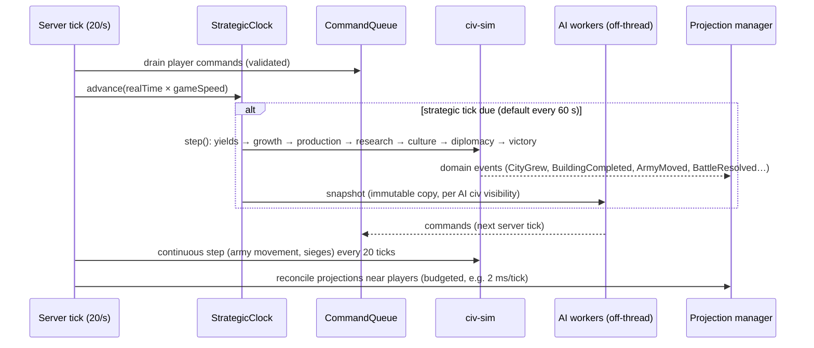
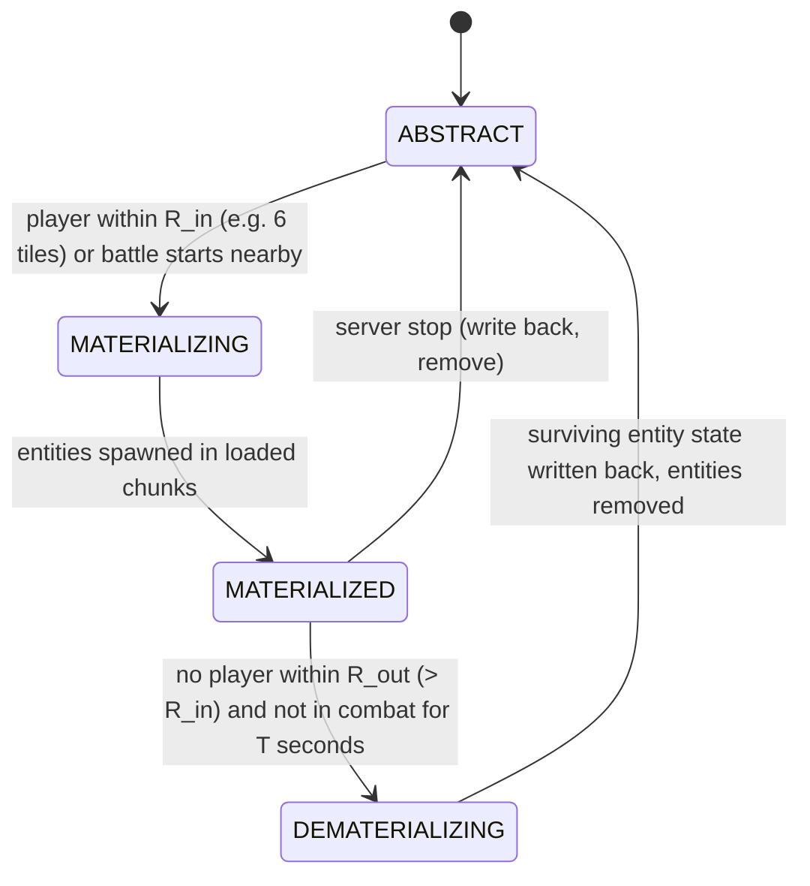
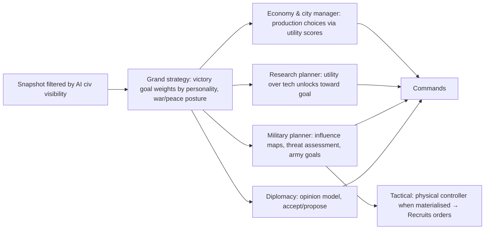

# D. System Architecture — Civ Core

## 1. Principles

1. **Server-authoritative strategic state.** One `GameState` per game on the server. Clients receive filtered views and send commands.
2. **The simulation knows nothing about Minecraft.** The `civ-sim` module is plain Java 17 with no Minecraft imports. It is unit-testable, runs headless for AI-vs-AI balance tests, and survives a platform change.
3. **Physical objects are projections.** MineColonies colonies, Recruits soldiers, OPAC claims and placed blueprints are *representations* of strategic objects, created and reconciled by adapters. If a projection disagrees with the strategic state, the strategic state wins (except for well-defined feedback such as combat casualties and completed construction).
4. **Players and AI use the same command API.** An AI civilisation is a controller that emits the same `Command` objects a player's UI does. No special AI paths through the rules.
5. **Everything distance-related goes through `Topology`.** Bounded, cylinder and torus maps are interchangeable.
6. **Deterministic core.** Simulation steps use a seeded RNG and ordered iteration so tests and replays are reproducible.

## 2. Module layout

```mermaid
flowchart TB
  subgraph sim["civ-sim (pure Java, no MC)"]
    model[Model: GameState, Civ, City, Tile, Army, Tech]
    rules[Rules: yields, growth, production, research, combat, culture, diplomacy, victory]
    clock[StrategicClock + CommandQueue]
    ai[AI controllers]
    topo[Topology: bounded / cylinder / torus]
    events[Domain events]
  end
  subgraph mod["civ-mod (NeoForge platform layer)"]
    boot[Lifecycle + config]
    persist[Persistence]
    net[Networking + view filtering]
    cmds[Brigadier commands]
    world[WorldPlan: map analysis, resources, starts]
    proj[Projection manager]
    ui[Client: strategic map, city, tech, diplomacy screens]
    protect[Fallback territory protection]
  end
  subgraph adapters["Adapters (separate jars, optional)"]
    mc[civ-compat-minecolonies (GPL-3.0)]
    rec[civ-compat-recruits]
    opac[civ-compat-opac]
    stages[civ-compat-gamestages]
    maps[civ-compat-xaero / journeymap]
    wrap[civ-compat-exoticworlds: world shape + seam guard]
  end
  sim --> mod
  mod --> adapters
```

- `civ-sim` depends on nothing but a JSON library and SLF4J.
- `civ-mod` depends on `civ-sim` and NeoForge.
- Each adapter depends on `civ-mod` and on one external mod, loaded only if that mod is present (`ModList.get().isLoaded(...)`). Splitting adapters into separate jars keeps licence boundaries clean (the MineColonies adapter is GPL-3.0; nothing else needs to be).

## 3. Core data model

All IDs are stable `long` or `UUID` values, never entity IDs or object references across subsystems.

```text
GameState
  meta: GameSettings (mapSize, tileSize, topology, speed, victory types, difficulty, seed), schemaVersion, strategicTurn
  map:  StrategicMap (W×H Tile records, immutable terrain + mutable ownership/improvements)
  civs: Map<CivId, Civilization>
  cities: Map<CityId, City>
  armies: Map<ArmyId, Army>
  diplomacy: DiplomacyState (pairwise Relation records)
  visibility: Map<CivId, VisibilityMap>
  rngState, pendingEvents

Tile
  x, z (tile coords), terrain: TerrainSummary (biome class, elevation band, water, river, hills/mountain, forest)
  feature: Optional<ResourceDeposit> (type, amount)
  owner: CivId?, workedBy: CityId?, improvement: ImprovementType?, cultureByCiv: small map

Civilization
  id, name, color, flag (banner pattern), leader (player UUID or AI personality)
  members: Set<UUID>, roles (leader/minister/citizen)
  capital: CityId, cities: List<CityId>
  treasury: gold, stockpiles: Map<StrategicResource, int>
  research: ResearchState (known techs, current, progress, queue)
  government, policies, eraIndex
  culture total, happiness/stability
  victoryProgress per type
  controller: HUMAN | AI(personalityId) | HYBRID (AI governor for offline nations)

City
  id, civ, originalOwner, name, centerTile, centerBlockPos, founded turn
  population, foodStored, productionStored
  buildings: Map<BuildingType, level>
  productionQueue: List<ProductionItem> (building, unit, project)
  workedTiles, specialists
  health (defense), garrisonArmy, occupation state
  physicalBinding: PhysicalBinding (adapter type, external id e.g. MineColonies colony id, generation)

Army
  id, civ, units: List<UnitRecord(type, hp, xp, equipmentTier)>
  position: tile + precise BlockPos hint, orders: Order queue, movementProgress
  supply, state: ABSTRACT | MATERIALIZING | MATERIALIZED | DEMATERIALIZING
  projectionGeneration: int

Relation (civA, civB)
  contact: bool, stance: WAR | PEACE | OPEN_BORDERS | ALLIANCE | VASSAL, treaties: List<Treaty>, opinion (AI), warScore
```

**Seam rules (from the Phase 0 spike):**
- No city centre within 3 tiles of a seam.
- Every target sent to another mod's pathfinding is `Topology.nearestCopy(target, unitPos)`, and it is re-sent after the unit crosses a seam.

Recruits and MineColonies both use raw coordinates.

Static content (tech tree, buildings, units, resources, governments, policies, eras) is **data-driven JSON** loaded from datapacks (`data/<ns>/civ/techs/*.json` etc.) via a NeoForge reload listener, then passed to `civ-sim` as an immutable `Ruleset`. This lets the pack author rebalance without code changes.

## 4. The strategic grid

**Recommendation: square tiles of 4×4 chunks (64×64 blocks).**

| Option | Pros | Cons |
|---|---|---|
| 1 chunk (16 blocks) | Matches claims exactly | Too fine: a 4,096 map is 65,536 tiles; city radius meaningless at that scale |
| **4×4 chunks (64 blocks)** | Medium map = 64×64 tiles (Civ "Standard"-like); a city's 2-tile radius ≈ 320 blocks across, about one MineColonies colony; aligns with chunk claims (16 claims per tile) | Coarser borders than Towny-style |
| Hexagons | Civ feel, uniform distance | Hex edges cut across chunks: claims, protection and map rendering need rasterisation; much more code everywhere; little player-visible benefit in first person |

Hex is **possible** (offset-coordinate hexes rasterised to chunks) but not desirable for 1.0. The tile grid is isolated behind `Topology`/`StrategicMap`, so hex adjacency could be added later without changing the data model, only neighbour/distance functions and rendering.

Adjacency: 8-neighbour; distance metric: octile (diagonal ≈ 1.5) for movement, Chebyshev for "radius" rules.

## 5. Topology

```java
interface Topology {
  int widthTiles(); int heightTiles();
  TilePos normalize(int x, int z);            // wraps or clamps
  int dx(int x1, int x2);                     // shortest signed delta
  int dz(int z1, int z2);
  double distance(TilePos a, TilePos b);
  boolean inBounds(int x, int z);
  BlockPos nearestCopy(BlockPos target, BlockPos observer); // for physical placement near a player
}
```

Implementations: `BoundedTopology`, `CylinderTopology` (wrap X), `TorusTopology` (wrap X and Z). On a torus, `dx = ((x2 - x1 + W/2) mod W) - W/2`. Every rule (city spacing, border growth, AI threat range, army movement, trade route length, start placement) uses it. This is what makes the wrapping decision reversible.

## 6. Simulation timing



- **Strategic tick** ("turn equivalent"): default 60 s real time, scaled by game speed (Quick 40 s / Standard 60 s / Epic 90 s / Marathon 180 s). All economy, growth, production and research happen here, so they are deterministic and cheap.
- **Continuous step** (once per second): army movement along paths, siege timers, occupation, visibility updates.
- **Pause:** configurable `pauseWhenEmpty` (default true for multiplayer, always for singleplayer when the game is paused). A `/civ pause` admin command freezes the clock.
- **AI off-thread:** AI controllers receive an immutable snapshot and return commands. They never mutate state, so thread safety is simple: only the server thread mutates `GameState`.
- **Budgets:** projection reconciliation and Minecraft-side work are budgeted per tick and spread over many ticks.

## 7. Strategic vs physical simulation

The central design problem. Same rules for cities and armies.

### 7.1 States



Hysteresis (`R_out > R_in`, plus a minimum dwell time) prevents flapping.

### 7.2 Rules that prevent duplication and loss

1. **Single authority per state.** In `ABSTRACT` the army record is authoritative and no entities exist. In `MATERIALIZED` the entities are authoritative for position, HP and deaths; the record is updated from them every second and on any event.
2. **Projection tags.** Every projected entity carries persistent NBT `civ:proj = {objectId, unitIndex, generation}`.
3. **Generation counter.** Every materialisation increments `projectionGeneration`. When any tagged entity loads from disk (`EntityJoinLevelEvent` with `loadedFromDisk`) and its generation does not match the current one, or its object is `ABSTRACT`, it is discarded immediately. This handles crashes, chunk saves of entities that were mid-transition, and players carrying entities across unload boundaries.
4. **Write-back before removal.** Dematerialisation writes HP, XP, equipment tier and position back, then calls `discard()`. Units that died are already removed from the record by the death handler.
5. **Pinned chunks while materialised.** A materialised army holds a chunk ticket over its area (NeoForge `TicketController`) so its entities are not saved and unloaded behind our back. Ticket released on dematerialise.
6. **No direct item conversion from entities.** Drops from killed projected soldiers are disabled or replaced by a fixed loot table; equipment is abstract (tier), so killing and respawning cannot duplicate gear.
7. **Shutdown:** on `ServerStoppingEvent`, everything dematerialises before the final save.

### 7.3 Combat consistency

- **Abstract vs abstract** (no players near): Civ-style resolution per continuous step: strength from unit types, HP, terrain, fortification, flanking; deterministic RNG.
- **Physical** (players near): real Minecraft combat between projected entities; casualties feed back.
- **Mixed transition:** a battle that starts abstract and gets a player nearby materialises both sides at their current HP. A battle never switches to abstract while players are within `R_out`.
- Balance: physical and abstract outcomes will differ. Calibrate abstract combat against measured physical outcomes (see [I](I-testing.md)) and accept modest variance.

### 7.4 Materialisation placement

Spawn positions are chosen by the projection manager in loaded or force-loaded chunks: find surface (`Heightmap.Types.MOTION_BLOCKING_NO_LEAVES`), avoid water/lava, lay out in a formation grid around the army's position hint. Never materialise inside a player's view distance edge in the open if avoidable; prefer the far side of the army's movement direction.

### 7.5 Cities

| City state | Physical representation |
|---|---|
| Abstract (no player near) | Strategic record only. MineColonies colony (if any) is UNLOADED/INACTIVE and does nothing |
| Loaded (player near) | Colony active. Adapter **reconciles**: buildings the strategic city has but the colony lacks become work orders (player cities) or instant blueprint pastes (AI cities, or if "fast catch-up" is enabled); building upgrades completed physically report back as `BuildingConstructionModEvent` → strategic city gains the level if it was queued |

Strategic yields never depend on MineColonies being loaded. MineColonies building levels act as **requirements and multipliers** (e.g. "Granary level ≥ 2 required for population > 8"; "each Farmer hut level +1 food"), read when the colony is loaded and cached in the city record.

## 8. Subsystems

| Subsystem | Owns | Key operations | Notes |
|---|---|---|---|
| WorldPlan | Tile terrain summary, resource deposits, start positions, natural wonders | Built once at game setup from the seed by sampling the chunk generator's noise (`ChunkGenerator#getBaseHeight`, `BiomeSource#getNoiseBiome` with `RandomState.sampler()`) without generating chunks | Immutable after setup; read by worldgen features on worker threads |
| Nations | Civs, membership, roles, government, policies | Found civ, invite, set roles, change government | Hybrid controller: an AI governor runs a human nation's cities while all its members are offline (configurable) |
| Cities | City records, production, growth | Found, queue production, assign tiles, capture, raze | Adapter: MineColonies / blueprint-paste |
| Territory | Tile ownership, culture pressure | Border growth from culture, purchase tile, transfer | Adapter: OPAC claims or built-in protection |
| Economy | Yields, treasury, stockpiles, trade routes, upkeep | Strategic-tick accounting | Item conversion via "Treasury" block, rate-limited |
| Research | Tech state, current research, eurekas | Choose research, complete tech, grant unlocks | Adapter: AStages sync or built-in gate, JEI hiding |
| Military | Armies, orders, supply, combat | Recruit, move, attack, siege, garrison | Adapter: Recruits (projection), Small Ships |
| Diplomacy | Relations, treaties, proposals | Declare war, propose peace/alliance/trade | Proposals expire after N strategic ticks |
| Visibility | Per-civ discovered tiles and last-seen info | Update from units/cities/borders each continuous step | Drives network filtering |
| Victory | Progress per type | Evaluate each strategic tick | Ends game, announces, freezes clock |
| AI | Controllers per AI civ | Produce commands from snapshot | See §11 |

## 9. Persistence and networking

**Persistence.**
- Store in `<world>/civcore/` as separate files per subsystem (`game.dat`, `map.dat`, `civs.dat`, `cities.dat`, `armies.dat`, `diplomacy.dat`, `visibility.dat`) using Minecraft `Codec`s → NBT, compressed. A `schemaVersion` with migration functions.
- Written on `LevelEvent.Save` (overworld) and on server stop, atomically (write `*.tmp`, then rename). Keep the last 3 backups.
- Rationale vs a single `SavedData`: the map and visibility data are large; separate files keep saves incremental and debuggable. Small per-chunk markers (e.g. "this resource deposit has been physically placed") use a chunk capability.
- Optional append-only event log (`events.log`) for debugging and replays.

**Networking** (NeoForge 1.21.1: `RegisterPayloadHandlersEvent` with `CustomPacketPayload` + `StreamCodec`).
- Server → client: `CivSnapshotPacket` (own civ full state), `MapDeltaPacket` (tiles newly discovered or changed, filtered by that civ's visibility), `ForeignCivSummaryPacket` (only what is known), `NotificationPacket`.
- Client → server: `CommandPacket` (serialised `Command`; validated server-side against permissions and rules).
- The server never sends unexplored tile data, enemy army positions outside vision, or other civs' research to a client. This is the secure strategic fog of war.

## 10. Client UI and strategic map

Custom screens (built with vanilla `Screen` widgets; BlockUI from ldtteam is an option since it ships with MineColonies):

| Screen | Content | Phase |
|---|---|---|
| Strategic map (key `M` or a "Map Table" block) | Tile grid rendered from `MapDeltaPacket` data: terrain colour, borders in civ colours, cities, known armies (with "last seen" ghosts), resources, trade routes; pan/zoom; wraps visually on a torus | MVP (simple) → Phase 5 (full) |
| City screen | Population, yields, production queue, buildings, worked tiles | MVP |
| Tech tree | Era columns, prerequisites, current research | MVP (list) → Phase 5 (graph) |
| Diplomacy | Known civs, stance, proposals | Phase 4 |
| Army screen | Units, orders, supply | Phase 3 |

Xaero/JourneyMap remain for local navigation and show OPAC territory automatically; the strategic map is the authoritative 4X view.

## 11. AI architecture



- **Utility AI** for choices (build what scores highest given needs: food deficit, threat, expansion room, goal).
- **Influence maps** on the tile grid for threat, opportunity and settle-site scoring.
- **Simple goal planner** for multi-step plans (e.g. "settle at X": produce settler → escort → move → found).
- **Personalities** = weight vectors in JSON (expansionist, militarist, scientific, cultural, trader).
- **Difficulty** = yield modifiers and decision quality (number of candidates evaluated), not hidden information. AI sees only its visibility map.
- Runs identically with zero players online; testable headless.
- No LLM: deterministic and cheap is preferred, and decisions must be reproducible.

## 12. Adapter interfaces (examples)

```java
interface CityProjection {            // implemented by MineColoniesCityProjection, BlueprintCityProjection
  PhysicalBinding found(City city, ServerLevel level, BlockPos center);
  void reconcile(City city, ServerLevel level);       // called when loaded
  PhysicalCityInfo read(City city);                    // building levels, citizens, when loaded
  void transferOwnership(City city, CivId newOwner);   // conquest
  void destroy(City city);                             // raze
}

interface ArmyProjection {            // RecruitsArmyProjection, FallbackSoldierProjection
  void materialize(Army army, ServerLevel level, Placement placement);
  void issueOrder(Army army, PhysicalOrder order);     // move/attack/hold → Recruits setters
  ArmyWriteBack collect(Army army);                    // HP, positions, deaths
  void dematerialize(Army army);
}

interface TerritoryEnforcement {      // OpacTerritory, BuiltinTerritory
  void setOwner(TilePos tile, CivId owner);            // claims 16 chunks
  void setWar(CivId a, CivId b, boolean atWar);        // protection exceptions
}

interface TechGate {                  // AStagesGate, BuiltinGate
  void syncPlayer(ServerPlayer p, Set<TechId> known);
}
```

The **fallback implementation** of each interface lives in `civ-mod` so the game runs with no optional mods installed. This is the MVP path and the safety net if a dependency breaks.

## 13. Server vs client responsibilities

| Server | Client |
|---|---|
| All game state, rules, AI, combat resolution, projections, persistence, visibility filtering, command validation | Rendering screens from received views, input → commands, map rendering, local interpolation |

No game logic runs client-side. Singleplayer uses the integrated server, so the same code paths apply.

## 14. Decisions that could force redesign later

1. Tile size (fixed per game; changing it later breaks balance and saves).
2. Topology abstraction (must be used everywhere from the first commit).
3. Projection/generation rules (must exist before the first projected entity).
4. Command API shared by AI and players.
5. `civ-sim` purity (no Minecraft types leak in).
