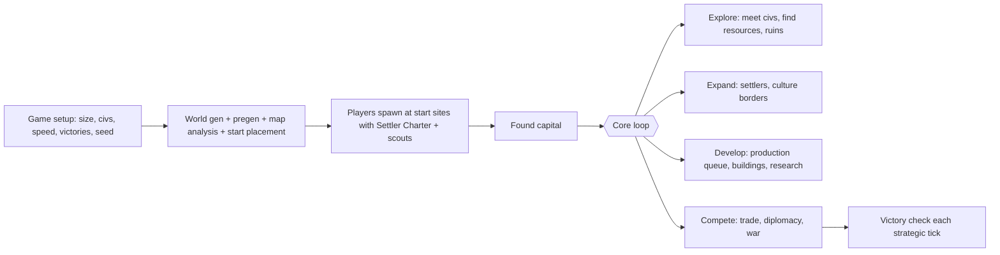

# F. Game Design Specification

## 1. Game flow

**Game setup** (`/civ setup` wizard or `civcore-game.toml` for servers): map size (Tiny/Small/Medium/Large), topology (bounded/cylinder/torus where supported), number of civs and how many are AI, AI difficulty, game speed, enabled victory types, time limit (for score victory), seed, pause-when-empty.

## 2. Time model

Minecraft runs continuously, so **turns become strategic ticks**.

| Element | Mechanic |
|---|---|
| Strategic tick | Every 60 s real time at Standard speed (Quick 40 s, Epic 90 s, Marathon 180 s). One tick ≈ one Civ turn of economy |
| Yields | Food, production, gold, science, culture accrue per strategic tick |
| Continuous actions | Army movement, sieges, exploration, building by NPCs, player activity |
| Typical game length | Ancient → Early Industrial ≈ 250–350 strategic ticks ≈ 4–6 hours at Standard speed; multi-session campaigns supported |
| Pause | Clock pauses when no players are online (default) or by admin |
| Offline nations | Configurable: frozen (production continues but no new orders), or AI governor manages cities but never declares war or accepts treaties |

Rationale: a Civ game is ~300 turns; at 60 s per turn, the game fits a few sessions. Players never wait for others, and nothing requires micromanaging every tick because production queues and research queues persist.

## 3. Core player actions

| Action | How in Minecraft |
|---|---|
| Found a civilisation | First city founding with a Settler Charter creates the civ (name, colour, banner as flag) |
| Found a city | Use a Settler Charter (consumable item, produced by cities as a unit) on a valid tile → places a City Center block, claims the tile and its 8 neighbours. Rules: min distance 3 tiles from another city, on land, not near map seam |
| Manage a city | Right-click City Center (or from strategic map): production queue, worked tiles, buildings |
| Order construction | Production queue item "Granary". On completion: player cities get a MineColonies work order/hut (Phase 2), AI cities get a blueprint paste. In MVP the building is strategic only plus a small marker structure |
| Research | Tech screen: pick current research and queue. Science comes from cities |
| Recruit units | Production queue: Warriors, Archers, Spearmen, Horsemen, Swordsmen, Knights, Musketmen, Cannons, Ships, Settlers, Scouts |
| Command armies | Army screen or strategic map: move to tile, attack city, garrison, fortify; when near, Recruits command UI also works (orders are mirrored) |
| Fight | Players fight alongside materialised units; player death has no strategic penalty beyond respawn at capital |
| Diplomacy | Diplomacy screen: proposals with terms; AI responds next strategic tick |
| Trade | Trade routes between cities (domestic or foreign) via caravan units; Treasury block converts physical goods to gold |

## 4. Economy

### Yields per strategic tick

- **Food** from worked tiles + buildings → growth when `foodStored ≥ growthThreshold(pop)`.
- **Production** from tiles + buildings → current production item.
- **Gold** from tiles, trade routes, buildings → treasury; pays building and unit upkeep.
- **Science** from population and buildings → current tech.
- **Culture** from buildings, wonders → border growth (one new tile per threshold), policies, culture victory.
- **Happiness/stability**: national; luxury resources and buildings raise it, cities and population lower it. Unhappy → yield penalties, then unrest.

Tile yields derive from `TerrainSummary` (e.g. grassland 2F, plains 1F1P, forest 1F1P, hills 2P, desert 0, coast 1F1G, river +1G), plus improvements and resources. A city works `population` tiles within radius 2 (5×5 tiles = 320×320 blocks).

### Hybrid physical/abstract economy

| Physical activity | Strategic effect | Exploit guard |
|---|---|---|
| MineColonies buildings (loaded) | Levels unlock and multiply city yields (e.g. Farmer level adds +1 food per level to the city, capped by worked farm tiles) | Levels are discrete and capped; reading happens at reconcile, not per item |
| Physical crops/ores harvested | Belong to players/colonies as items; **do not** feed national yields directly | Prevents auto-farm/duplication inflation |
| Treasury block (player deposits items) | Converts items to gold/production at market prices with diminishing returns per city per strategic tick | Rate limit + price decay; blacklist duplicable items |
| Strategic resource deposit in territory + improvement (mine/pasture) | +N units of iron/horses/coal in national stockpile | Abstract count; can't be mined out by players; physical ore at deposit is cosmetic/bonus |
| Create machinery (Early Industrial) | "Factory" building requires Create tech; physical Create setups in city radius may grant +% production (adapter reads a registered "industrial output" block) | Capped bonus |

Strategic resources are **abstract counts tied to geography**: e.g. Iron 6 from a mine; Swordsmen require 1 Iron each while they exist. Luxuries give happiness. Resources are placed by the WorldPlan and marked physically (ore veins, special blocks, animal herds) so exploration finds them.

### Trade and infrastructure

- **Roads** (Phase 2): a worker unit/order builds a road along tiles (physical path blocks placed by a road-building projection); roads reduce army movement cost and connect cities (connection = gold bonus, fast travel for players between connected cities).
- **Trade routes**: caravan unit assigned origin→destination; yields gold to both per strategic tick; requires peace/open borders; can be plundered by enemy armies on the route.
- **Ports/shipping**: Harbor building enables naval units and sea trade routes.

## 5. Technology

Three eras for 1.0, ~12 techs each (≈36 total). Data-driven JSON. Example (abridged):

| Era | Techs | Example unlocks |
|---|---|---|
| Ancient | Agriculture, Pottery, Animal Husbandry, Mining, Archery, Bronze Working, Sailing, Writing, Masonry, The Wheel, Calendar, Trapping | Granary, Library, Walls, Archers, Spearmen, Galley, roads; physical: stone tools, bows, boats |
| Medieval | Iron Working, Mathematics, Currency, Philosophy, Construction, Horseback Riding, Feudalism, Engineering, Civil Service, Chivalry, Machinery, Theology | Market, Castle, Swordsmen, Knights, Catapult/Trebuchet, Cog/Caravel, governments (Monarchy, Republic); physical: iron gear, Epic Knights armour |
| Early Industrial | Gunpowder, Printing Press, Banking, Navigation, Astronomy, Metallurgy, Economics, Scientific Theory, Steam Power, Industrialization, Railroad, Military Science | Musketmen, Cannons, Galleon, Bank, University, Factory (Create), Railroad (Create trains); science victory projects |

Research is **nation-wide**: progress and unlocks belong to the civ; every member gets the corresponding tech stages (built-in gate or AStages) on login/join. Gating covers recipes and items (physical), and buildings/units/governments (strategic). "Eureka" boosts: physical achievements (e.g. first ship built, first ore of a resource mined) give 25% toward a tech.

## 6. Warfare

| Element | Design |
|---|---|
| Units | Strategic unit types with strength, ranged strength, movement, upkeep, resource cost; projected as Recruits entities (recruit, bowman, shieldman, horseman…) with era equipment |
| Armies | Groups of up to N units (default 10) moving as one strategic piece |
| Movement | Along the tile grid; terrain costs; roads halve cost; embarkation at coast after Sailing |
| Upkeep | Gold per unit per strategic tick; supply drops outside own/allied territory; unsupplied units lose HP |
| City defense | City has HP and strength (Walls/Castle add); garrisoned army fights from city |
| Siege | Army adjacent to a city at war starts a siege; city HP drains based on siege strength (siege units multiply) |
| Capture | City HP 0 + a unit occupies the City Center tile for a hold timer (e.g. 2 strategic ticks) with no defenders → ownership transfers. Capital capture counts for domination. Options: keep, raze (not capitals), liberate |
| Physical role | When players are near, the battle is physical: soldiers fight; players can fight; the City Center block is the objective (must be held, not broken). Walls are real structures but city HP is abstract; breaking arbitrary blocks never captures a city |
| Naval | Small Ships projected for fleets; abstract naval combat otherwise |
| Conquest effects | Territory tiles of the city transfer; MineColonies colony ownership transfers via `IPermissions.setOwner` / proxy owner; citizens become unhappy for N ticks |

Block protection: in peace, foreign territory is protected (OPAC or built-in). At war, protection lifts only within N tiles of a besieged city and only for siege-capable actions (configurable), to avoid griefing-driven gameplay.

## 7. Diplomacy, government, culture

- **First contact** when units/borders see another civ → relation created.
- **Stances**: War, Peace (default after contact), Open Borders, Defensive Pact, Alliance, Vassal.
- **Proposals**: declare war (requires a cooldown since last peace), peace (with terms: gold, cities, resources), open borders, resource trade (per tick for N ticks), research agreement, alliance.
- **AI opinion** model: shared borders (−), shared enemies (+), trade (+), broken treaties (−), relative strength.
- **City-states** (Phase 5): independent minor civs (AI with no expansion) offering bonuses for influence.
- **Governments** (unlocked by tech): Chiefdom → Monarchy / Republic / Theocracy → Constitutional Monarchy / Merchant Republic. Each with policy slots.
- **Policies**: cards bought with culture (e.g. "Agrarian Reform" +1 food in cities, "Professional Army" −25% upkeep).
- **Stability**: unhappiness reduces growth; very low causes revolt (production stop; at extreme, city flips to independent).

## 8. Exploration and fog of war

- Each civ has a visibility map: tiles never seen are unexplored (black on the strategic map); seen but not currently visible tiles show last-known state.
- Vision from city tiles (radius 3), units (radius 2, scouts 3), players physically present (radius 2 around them, so walking around explores).
- Ruins/goody huts (Towns and Towers structures or our own) give one-time rewards when entered.
- Server never sends unknown strategic data; terrain loaded by a client is visible in the normal Minecraft view, which is acceptable.

## 9. Victory

| Victory | Condition (1.0) |
|---|---|
| Domination | Control all original capitals (including your own) |
| Science | Complete the Early Industrial project chain (e.g. "Great Survey" → "Steam Expedition" → "World Exhibition") requiring specific techs and production |
| Culture | Accumulate culture ≥ threshold scaled by map size and have the most culture by margin X% for N ticks |
| Diplomatic (Phase 5+) | World Congress votes; win a vote with majority |
| Score | When time limit reached, highest score (population, territory, techs, wonders, culture) |

## 10. Players, sessions, edge cases

- **Late join**: join an existing civ as a member by invite; or found a new civ only within the first X strategic ticks (configurable); otherwise spectator.
- **Elimination**: civ eliminated when it has no cities. Members become spectators or may join a living civ (configurable).
- **Respawn**: at capital or nearest own city.
- **Spectators**: spectator mode; may see full strategic map only if the game setting allows (otherwise only after game ends).
- **Persistence**: everything persists across restarts; the clock resumes.
- **Singleplayer**: one human civ vs AI civs; pause when the game is paused.
