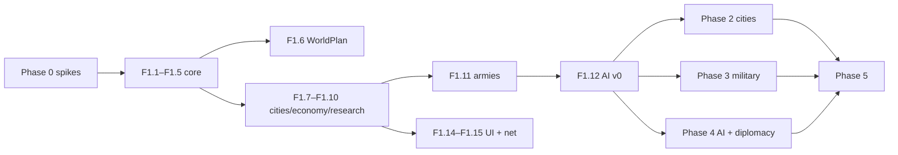

# G. Prioritized Implementation Backlog

**Priority:** P0 = MVP-blocking · P1 = needed for a real game (Phases 2–4) · P2 = full 1.0 · P3 = later.
**Effort** (relative, one experienced modder): S ≤ 3 days · M ≈ 1–2 weeks · L ≈ 3–5 weeks · XL > 5 weeks.
**Risk:** L/M/H/VH.

## Phase 0 — Feasibility spikes

| ID | Feature | Pri | Depends | Reuse | Custom work | Risk | Effort | Acceptance criteria |
|---|---|---|---|---|---|---|---|---|
| S0.1 ✅ | Platform spike (done 2026-11-08: NeoForge 1.21.1 adopted) | P0 | — | Exotic Worlds, MineColonies, Recruits, Tectonic, Terralith (NeoForge 1.21.1) | Test world + checklist | H | S | Written report: loads together on a dedicated server; torus crossing works for player/boat/arrow/recruit; colony near seam OK or not; go/no-go decision recorded |
| S0.2 | Pack compatibility baseline (NeoForge 1.21.1; core set done, full pack pending) | P0 | — | All essential mods in [C](C-modpack-foundation.md) | packwiz pack | M | S | Dedicated server and client boot with full pack; no errors in log; 30 min idle TPS 20 in Medium pregen world |
| S0.3 ✅ | MineColonies proxy-owner spike | P0 | S0.2 | MineColonies API | Test mod | H | S | Code creates 2 colonies for one nation via FakePlayer/proxy UUID owners; real players added as officers; colony works when a member is nearby; finding on whether FakePlayer owner keeps colony ACTIVE recorded |
| S0.4 ✅ | Recruits bridge spike | P0 | S0.2 | Recruits public setters/events | Test mod | M | S | Code spawns 10 recruits owned by a proxy, groups them, orders move to BlockPos and attack; despawn and respawn by code with no duplicates after server restart |
| S0.5 ✅ | OPAC proxy claim spike | P1 | S0.2 | OPAC API | Test mod | M | S | `tryToClaim` with a nation proxy UUID claims chunks that block non-members; Xaero shows claims in nation colour |
| S0.6 ✅ | World preset | P0 | S0.2 | Exotic Worlds presets, Tectonic, Terralith | — | L | S | Small: 8 min 41 s pregen, 205 MB (measured); Medium/Large extrapolated |
| S0.8 | AI-city blueprint paste | P1 | S0.3 | Structurize placement API | Spike | M | S | A town hall pasted by code reaches L1 (the spike's `CreativeBuildingStructureHandler` attempt placed nothing) |
| S0.7 | Performance baseline | P0 | S0.3, S0.4 | spark | Scripts | M | S | spark reports for: 1 colony 50 citizens; 3 colonies; 200 recruits fighting; numbers recorded in docs |

## Phase 1 — MVP (see [H](H-mvp.md))

| ID | Feature | Pri | Depends | Reuse | Custom work | Risk | Effort | Acceptance criteria |
|---|---|---|---|---|---|---|---|---|
| F1.1 ✅ | Repo + Gradle multi-project | P0 | S0 decisions | ModDevGradle, Parchment | `civ-sim`, `civ-mod` | L | S | `gradlew build` produces mod jar; `gradlew :civ-sim:test` runs JUnit; CI on push |
| F1.2 ✅ | Core model + Topology | P0 | F1.1 | — | GameState, Civ, City, Tile, Army, Bounded/Torus topology, `nearestCopy`, `distanceToSeam` | L | M | Unit tests: torus distance symmetric and ≤ W/2; serialisation round-trip equals |
| F1.2b ✅ | Seam guard + seam rules | P0 | F1.1 | Spike mixin | Move `SeamSnapGuardMixin` into civ-mod; city exclusion zone | L | S | `seam_stress.py` shows 0 crashes with Recruits async on; founding within 3 tiles of a seam is rejected |
| F1.3 ✅ | Ruleset loading (JSON) | P0 | F1.2 | NeoForge reload listeners | Techs, buildings, units, terrain yields | L | M | Datapack JSON loads; invalid reference reports clear error; ruleset hash in save |
| F1.4 ✅ | Strategic clock + command queue | P0 | F1.2 | — | Tick scheduling, pause, speed | L | S | 1-hour headless run executes exactly expected tick count; pause stops progress |
| F1.5 ✅ | Persistence (JSON for now) | P0 | F1.2 | Codecs | `<world>/civcore/*.dat`, atomic writes, schema version | M | M | Kill server mid-game → restart → state identical to last save; 3 backups rotated |
| F1.6 ✅ (resources pending) | WorldPlan: map analysis | P0 | F1.2, S0.6 | Chunk generator noise sampling | Tile terrain summary, resource placement, start positions | M | M | Medium map analysed < 30 s; starts ≥ min distance apart; each start has ≥ minimum food/production within radius 2 |
| F1.7 ✅ (needs in-game check) | City founding + City Center block | P0 | F1.4 | — | Settler Charter item, City Center block entity, founding rules | L | M | Player founds capital → civ created; invalid sites rejected with message; city persists |
| F1.8 ✅ | Territory + built-in protection | P0 | F1.7 | — | Tile ownership, culture border growth, break/place protection | L | M | Non-members cannot break/place in territory; border grows one tile when culture threshold reached |
| F1.9 | Yields, growth, production | P0 | F1.3, F1.7 | — | Economy step | M | M | Unit-tested formulas; city grows and completes buildings in expected ticks |
| F1.10 | Research | P0 | F1.3 | AStages (optional) | Research step, unlocks, member stage sync | L | M | Tech completion unlocks building/unit; all members get stage; JEI hides locked items |
| F1.11 ✅ | Abstract armies + combat (no physical) | P0 | F1.9 | — | Army movement on grid, abstract combat, siege, capture | M | L | Army moves at expected speed; capture transfers city and tiles; unit tests for combat math |
| F1.12 ✅ | Deterministic AI controller v0 | P0 | F1.9–F1.11 | — | Utility AI: expand, build, research, attack weakest neighbour | H | L | Headless 2-AI game reaches a victory within 400 ticks in ≥ 80% of 100 seeded runs |
| F1.13 ✅ | Victory: domination + score | P0 | F1.11 | — | Victory checks, end-of-game | L | S | Capturing all capitals ends game with announcement; time limit → score winner |
| F1.14 ✅ (needs in-game check) | Commands + minimal UI | P0 | F1.7–F1.13 | — | `/civ` commands; city screen; tech list; simple strategic map | M | L | A player can play the MVP without commands except setup |
| F1.15 ✅ | Networking + visibility | P0 | F1.14 | — | Snapshot/delta packets, per-civ filtering | M | M | Client never receives unexplored tiles or unseen armies (packet inspection test) |
| F1.16 | Physical city marker | P1 | F1.7 | Structurize paste | Small blueprint per era/size | L | S | City Center surroundings visibly grow (tier blueprints) when city size thresholds pass |

## Phase 2 — Physical cities and economy

| ID | Feature | Pri | Depends | Reuse | Custom work | Risk | Effort | Acceptance criteria |
|---|---|---|---|---|---|---|---|---|
| F2.1 | MineColonies city projection | P1 | S0.3, F1.7 | MineColonies API, event bus | `civ-compat-minecolonies`: found colony with proxy owner, members as officers, reconcile queue → work orders | H | XL | Founding a player city creates a colony; queued Granary becomes a builder work order; completed hut reports back; works after restart |
| F2.2 | Building ↔ yield mapping | P1 | F2.1 | — | Config mapping MineColonies building types/levels → city modifiers | M | M | Raising a Farmer hut level changes city food after reconcile; capped |
| F2.3 | AI city blueprint projection | P1 | F1.16 | Structurize | Era style pack; catch-up paste on load | M | M | Walking to an AI city shows buildings matching its strategic buildings |
| F2.4 | OPAC territory enforcement | P1 | S0.5, F1.8 | OPAC API | Adapter | M | M | Tiles claimed in OPAC within 1 s of ownership change; Xaero displays them |
| F2.5 | Strategic resources | P1 | F1.6 | — | Deposits, improvements, stockpiles, physical markers | M | M | Iron deposit inside borders + mine → +iron; units requiring iron blocked without it |
| F2.6 | Treasury block + currency | P1 | F1.9 | Lightman's Currency (optional) | Item→gold conversion with diminishing returns | M | M | Repeated deposits yield decreasing gold; blacklisted items refused |
| F2.7 | Roads and connections | P2 | F1.11 | — | Road orders, path placement, connection bonus, fast travel | M | L | Connected cities gain gold; travel command teleports between connected cities |
| F2.8 | Trade routes | P2 | F2.7 | — | Caravans, route yields, plunder | M | M | Route generates gold to both civs; enemy army on route stops it |
| F2.9 | Happiness/stability | P1 | F1.9 | — | Happiness model, luxury resources | L | M | Expanding beyond limit causes growth penalty |

## Phase 3 — Military and conquest

| ID | Feature | Pri | Depends | Reuse | Custom work | Risk | Effort | Acceptance criteria |
|---|---|---|---|---|---|---|---|---|
| F3.1 | Projection manager (generation tags) | P1 | F1.11 | NeoForge ticket controllers | Materialise/dematerialise lifecycle | VH | L | 1,000 randomized materialise/unload/crash cycles: zero duplicated or lost units |
| F3.2 | Recruits army projection | P1 | F3.1, S0.4 | Recruits | `civ-compat-recruits` | H | L | Army near player appears as recruits with right count/HP; orders from strategic map move them |
| F3.3 | Physical battle feedback | P1 | F3.2 | — | Casualty/HP write-back, battle start/end detection | H | M | Kill 3 recruits → army record shows 3 fewer units |
| F3.4 | Physical siege and capture | P1 | F3.2 | — | City Center hold timer, war-time protection rules | M | M | Holding center with no defenders for timer captures city in physical play |
| F3.5 | Naval units | P2 | F3.2 | Small Ships | Ship projection, embarkation | H | L | Fleet materialises as ships with crew; transports carry armies |
| F3.6 | Upkeep and supply | P1 | F1.11 | — | Gold upkeep, supply attrition | L | S | Negative gold disbands units; out-of-supply units lose HP |
| F3.7 | AI tactical controller | P1 | F3.2 | Recruits AI | Orders for materialised AI armies (target, retreat) | H | L | AI army attacks player city physically and retreats below 30% strength |
| F3.8 | Fallback soldier entity | P2 | F3.1 | vanilla AI | Simple own soldier if Recruits unavailable | M | M | Game playable with Recruits removed |

## Phase 4 — AI and diplomacy

| ID | Feature | Pri | Depends | Reuse | Custom work | Risk | Effort | Acceptance criteria |
|---|---|---|---|---|---|---|---|---|
| F4.1 | Diplomacy model + UI | P1 | F1.15 | — | Relations, treaties, proposals | M | L | Player and AI can declare war, make peace with terms, open borders |
| F4.2 | AI diplomacy | P1 | F4.1 | — | Opinion model, accept/propose | H | L | AI accepts peace when losing, denounces aggressors; seeded tests |
| F4.3 | AI economy & research v1 | P1 | F1.12 | — | Personalities, goal planner, influence maps | H | XL | AI-only 4-civ games: varied winners by personality; no AI stalls (zero cities growing for 50 ticks) |
| F4.4 | AI military v1 | P1 | F4.3, F3.6 | — | Threat assessment, army composition, siege planning | H | L | AI defends when threatened, captures weak neighbours |
| F4.5 | Offline-nation AI governor | P2 | F4.3 | — | Hybrid controller | M | M | Offline human civ keeps producing defenders; never declares war |

## Phase 5 — Full integration

| ID | Feature | Pri | Depends | Reuse | Custom work | Risk | Effort | Acceptance criteria |
|---|---|---|---|---|---|---|---|---|
| F5.1 | Full strategic map | P1 | F1.15 | — | Pan/zoom, overlays, wrapping, last-seen ghosts | M | L | All layers render for Medium map at 60 FPS |
| F5.2 | Tech tree graph UI | P2 | F1.10 | — | Graph screen | L | M | Prerequisite lines; queue by clicking |
| F5.3 | Governments + policies | P2 | F1.10 | — | Data-driven governments, policy cards | L | M | Switching government changes modifiers |
| F5.4 | Science + culture victories | P2 | F1.13 | — | Project chains, culture victory | L | M | Each victory achievable in a test game |
| F5.5 | Exotic Worlds integration polish | P2 | S0.1 | Exotic Worlds API | World-shape binding, size presets in setup wizard, strategic map wrap rendering | M | M | Setup picks the preset; strategic map scrolls endlessly; circumnavigation by ship |
| F5.6 | Game setup wizard + presets | P1 | F1.6 | — | GUI + config | L | M | New game configured without editing files |
| F5.7 | City-states | P3 | F4.3 | Towns and Towers structures | Minor AI | M | L | — |
| F5.8 | Map mod overlays | P3 | F5.1 | JourneyMap API or Xaero | Overlay plugin | M | M | Borders/cities visible on minimap |
| F5.9 | Create integration (industry) | P2 | F2.2 | Create | Industrial output adapter | M | M | Factory building with Create setup gives capped production bonus |

## Phase 6 — Release

| ID | Feature | Pri | Depends | Effort | Acceptance criteria |
|---|---|---|---|---|---|
| F6.1 | Large-map load test | P1 | all | M | 8 civs, 12 players, Large map: average MSPT < 40 over 2 h |
| F6.2 | Balance pass via headless sims | P1 | F4.* | L | Win rate per personality within 15–35% in 1,000 AI games |
| F6.3 | Docs, configs, CurseForge release | P1 | all | M | Pack exports cleanly; server pack builds; player guide published |

## Parallelisation

After `F1.1–F1.5`, three tracks can run in parallel by different developers: **sim rules + AI** (pure Java), **world + projection** (NeoForge side), **UI + networking** (client). Phases 2, 3 and 4 are mostly independent once the MVP is stable.
